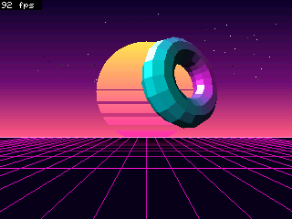
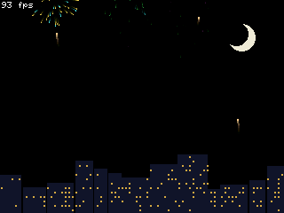
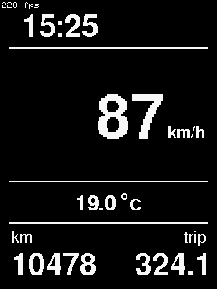

# ILI9341_GFX

Schneller ILI9341-Treiber für den ESP32, kompatibel zu **Adafruit_GFX**. Er bringt einen Framebuffer für flackerfreie Animationen mit hoher Bildrate mit.

| Plasma | Synthwave | Feuerwerk | Diagramm | Bordcomputer |
|---|---|---|---|---|
|  |  |  |  |  |

Die Bilder sind echte Screenshots, die per Readback aus dem Display-RAM gelesen wurden.

## Funktionen

- **Adafruit_GFX-kompatibel:** Text, Fonts, Linien, Kreise und Bitmaps funktionieren direkt. Die API orientiert sich an `Adafruit_ILI9341`, bestehender Code läuft weitgehend unverändert. Linien, Kreise, Dreiecke und Text sind schnelle Neuimplementierungen, die **pixelgleich** mit Adafruit_GFX zeichnen. Rund 1500 Host-Testfälle prüfen das automatisch.
- **Eigener SPI-Treiber auf Registerebene:**
  - Asynchrone DMA-Befehlsliste mit Interrupt.
  - Direkter Registerweg für kleine Transfers.
  - Kein Umweg über die ESP-IDF-Transaktions-API.
- **Gepackter Modus mit Hardware-DC:**
  - Die SPI-Einheit läuft im Dual-Modus, ihre zweite Datenleitung ist über die GPIO-Matrix auf den DC-Pin gelegt.
  - Dadurch gehen Fenster, Befehl und Pixel als **eine** Übertragung raus statt als sechs.
  - Das ist taktgenau und braucht keine Änderung an der Verdrahtung.
- **Framebuffer** (`ILI9341_Framebuffer`, 16 Bit / 150 KB, oder `ILI9341_Framebuffer8`, RGB332 bzw. Palette, 75 KB):
  - Gezeichnet wird ins RAM, `display()` überträgt nur geänderte Bereiche.
  - Änderungen werden über Hashes je 32-Pixel-Segment erkannt und zu Rechtecken zusammengefasst.
  - Die Übertragung läuft per DMA, parallel zum Rendern des nächsten Bildes.
- **VSync:**
  - Die Scanline des Panels wird gelesen, geschrieben wird hinter dem Bildaufbau her.
  - Das verhindert Tearing.
  - Die Bildwiederholrate wird automatisch kalibriert.
- **Hardware-Scrolling** (VSCRDEF/VSCRSADD) mit fixen Rändern, auch zusammen mit dem Framebuffer.
- **Weitere Funktionen:**
  - Readback des Display-RAMs, Screenshots als PNG über die serielle Schnittstelle.
  - `autoSpeed()` ermittelt den höchsten fehlerfreien SPI-Takt.
  - Stromsparmodi: Idle, Teilanzeige, Schlaf.
- Andere Plattformen funktionieren über die Arduino-`SPI`-Klasse, aber ohne die ESP32-Beschleunigungen.

## Benchmark

Die Messung lief auf einem NodeMCU-32S mit 40 MHz SPI und denselben Tests für alle Bibliotheken (Werte in ms, kleiner ist besser):

| Test | Adafruit_ILI9341 | TFT_eSPI | LovyanGFX | Arduino_GFX | **ILI9341_GFX** |
|---|---:|---:|---:|---:|---:|
| FillScreen | 184,9 | 156,0 | 154,2 | 170,4 | **154,2** |
| Text | 25,9 | 13,3 | 9,3 | 16,9 | **6,8** |
| Lines | 1019,7 | 268,6 | 274,0 | 413,4 | **200,8** |
| HV-Lines | 17,0 | 14,4 | 13,9 | 14,9 | **13,2** |
| Rects | 11,2 | 8,9 | 8,7 | 9,6 | **8,6** |
| FilledRects | 379,4 | 320,2 | **316,6** | 349,6 | 317,3 |
| FilledCircles | 70,3 | 47,0 | 44,3 | 52,2 | **40,9** |
| Circles | 114,6 | 26,5 | 26,5 | 40,7 | **19,8** |
| Triangles | 56,9 | 16,8 | 16,4 | 23,7 | **12,0** |
| FilledTriangles | 144,3 | 112,6 | **108,6** | 124,4 | 112,3 |
| RoundRects | 46,8 | 16,7 | 13,3 | 21,5 | **12,9** |
| FilledRoundRects | 390,7 | 326,9 | **322,6** | 362,3 | 324,9 |
| PushImage 320×240 | 36,1 | 33,4 | 31,3 | 34,8 | **30,9** |
| Animation Vollbild (fps) | – | 25,5 | 31,4 | – | **71,0** |

Die großen Flächen (FillScreen, FilledRects) sind durch die Leitung begrenzt: 40 MHz ergeben etwa 5 KB/ms. Mehr Takt verträgt das getestete Panel nicht. Eine Messung bei 80 MHz per Readback ergab fehlerhafte Pixel.

## Hardware

Getestet mit einem NodeMCU-32S (ESP32) und einem 2,8"-ILI9341-Modul mit SPI:

| Display | ESP32 | Hinweis |
|---|---|---|
| SCK | GPIO 18 | VSPI, über IOMUX |
| MOSI (SDI) | GPIO 23 | VSPI, über IOMUX |
| MISO (SDO) | GPIO 19 | nötig für VSync, Readback, Screenshots, `autoSpeed()` |
| CS | GPIO 15 | |
| DC | GPIO 2 | beliebiger ausgabefähiger Pin (GPIO 0–33) |
| RESET | GPIO 4 | oder -1 (Software-Reset) |
| LED | GPIO 13 | Hintergrundbeleuchtung |
| VCC / GND | 3V3 / GND | |

Der Treiber belegt VSPI (SPI3) exklusiv.

## Schnellstart

```cpp
#include <ILI9341_GFX.h>
#include <ILI9341_Framebuffer.h>

ILI9341_GFX tft(15, 2, 4);          // CS, DC, RST (SCK 18, MOSI 23, MISO 19)
ILI9341_Framebuffer fb(tft);

void setup() {
  tft.begin();                      // 40 MHz, gepackter Modus an
  fb.begin();                       // 150 KB Framebuffer
  fb.setRotation(1);
  fb.setVSync(true);                // tearing-frei (braucht MISO)
}

void loop() {
  fb.fillScreen(ILI9341_BLACK);
  fb.fillCircle(160 + 100 * sin(millis() / 500.0), 120, 30, ILI9341_ORANGE);
  fb.display();                     // nur Geändertes übertragen
}
```

Weitere Beispiele: [`Basic`](lib/ILI9341_GFX/examples/Basic/Basic.ino) zeichnet direkt aufs Display, [`Framebuffer`](lib/ILI9341_GFX/examples/Framebuffer/Framebuffer.ino) zeigt eine Animation mit VSync.

## API im Überblick

### `ILI9341_GFX` (direkt aufs Display)

| Funktion | Zweck |
|---|---|
| `begin(freq = 40 MHz, dmaBuffers = 8)` | Initialisierung. Mehr DMA-Puffer erlauben mehr Überlappung, kosten aber Heap (je 6,4 KB). |
| alle `Adafruit_GFX`-Funktionen | Zeichnen, Text, Fonts |
| `finishWrites()` | wartet, bis alle DMA-Übertragungen fertig sind |
| `pushImage(x, y, w, h, data)`, `drawCanvas(x, y, canvas)` | RGB565-Daten blitten |
| `setAddrWindow`, `writePixels`, `writeColor` | Low-Level-Zugriff innerhalb von `startWrite()`/`endWrite()` |
| `setSPISpeed(freq)`, `autoSpeed(maxFreq)` | Takt setzen bzw. per Readback ermitteln |
| `setPacked(bool)`, `verifyPacked()` | gepackten Modus schalten bzw. per Readback prüfen |
| `readRect(x, y, w, h, out)`, `readRegister`, `getScanline()` | Lesen (braucht MISO) |
| `setScrollMargins(top, bottom)`, `scrollTo(y)` | Hardware-Scrolling |
| `setIdleMode`, `setPartialMode`, `enableSleep`, `enableDisplay` | Stromsparen |
| `setFrameRate(diva, rtna)`, `setMadctl`, `sendCommand` | Registerzugriff |

Hinweis zur Asynchronität: `endWrite()` wartet nicht auf das Ende der Übertragung. Die Daten werden vorher kopiert, übergebene Puffer dürfen also sofort weiterverwendet werden.

### `ILI9341_Framebuffer` / `ILI9341_Framebuffer8`

| Funktion | Zweck |
|---|---|
| `begin()` | Puffer anlegen (nach `tft.begin()`), `false` bei zu wenig RAM |
| alle `Adafruit_GFX`-Funktionen | zeichnen ins RAM |
| `display()` | geänderte Bereiche übertragen |
| `invalidate()` | nächstes `display()` überträgt alles, etwa nachdem direkt auf `tft` gezeichnet wurde |
| `setVSync(bool)`, `refreshHz()`, `vsyncLate()` | tearing-freie Übertragung |
| `setScrollArea(fixedStart, fixedEnd)`, `scroll(delta)` | Hardware-Scrolling mit Framebuffer |
| `getRow(y)`, `markDirty(...)`, `getPixel(x, y)`, `pushImage(...)` | direkter Pufferzugriff |
| `screenshot(Print&)` | Bildschirminhalt per Readback als Datenstrom (PNG über `tools/tftctl.py`) |
| `setPalette(colors, n)`, `useRGB332()`, `color332()` | nur 8 Bit: Farbmodell |

## Wie es funktioniert

- **Zwei Wege zum Panel:**
  - Kleine Übertragungen bei leerer Befehlsliste gehen direkt über die SPI-Register W0–W15, ohne Interrupt.
  - Größere Übertragungen laufen über einen Ring aus 64 Einträgen mit DMA aus 6,4-KB-Puffern. Die Interrupt-Routine startet jeweils den nächsten Eintrag, die CPU rechnet derweil weiter.
- **Gepackter Modus:**
  - Der ILI9341 tastet D/CX nur beim letzten Bit jedes Bytes ab.
  - Im Dual-Modus gibt die SPI-Einheit pro Takt zwei Bits aus: MOSI bekommt das Datenbit, die Q-Leitung (über die GPIO-Matrix am DC-Pin) den passenden D/CX-Pegel.
  - Jedes Byte wird dafür auf 16 Pufferbits gespreizt. So passt `CASET x0 x1 PASET y0 y1 RAMWR` samt ersten Pixeln in eine einzige Übertragung.
  - Auch Einträge der Befehlsliste können gepackt sein: Die Interrupt-Routine spreizt sie selbst.
- **Framebuffer-Abgleich:**
  - Je 32-Pixel-Segment wird ein FNV-Hash gespeichert.
  - Nur Segmente, in die gezeichnet wurde, werden neu gehasht.
  - Geänderte Segmente werden zu Bändern und Rechtecken zusammengefasst. Ein neues Fenster lohnt sich ab etwa 200 Pixeln Lücke.
- **VSync:**
  - Ein Scanline-Lesebefehl (45h) liefert die aktuelle Zeile.
  - Übertragen wird in nativer Zeilenrichtung des Panels, immer hinter dem Strahl her.
  - Eine Machbarkeitsrechnung wählt die passende Bildrate (92, 55 oder 48 Hz) und verhindert, dass der Strahl überholt wird.

Ausführliche Notizen zu ESP32-Eigenheiten (DMA-Reset, Vollduplex-Effekte, späte `trans_done`-Flags) stehen als Kommentare im Quelltext.

## Projektstruktur

```
lib/ILI9341_GFX/        Bibliothek (Treiber, Framebuffer, Beispiele)
src/main.cpp            Demo-Firmware: 5 Szenen, Messinterface über Serial
bench/                  Vergleichsbenchmark gegen andere Bibliotheken
tools/tftctl.py         Demo steuern, fps/Readback lesen, Screenshots als PNG
tools/benchrun.py       Benchmark-Firmwares nacheinander flashen und auswerten
test/host/              Host-Tests: Pixelgleichheit mit Adafruit_GFX
docs/screenshots/       Bilder fürs README
```

## Bauen und Flashen

Gebaut wird mit [PlatformIO](https://platformio.org/). Port und Baudrate stehen in `platformio.ini` (`/dev/cu.usbserial-0001`) und müssen eventuell angepasst werden.

```sh
pio run -e nodemcu-32s -t upload        # Demo
pio device monitor                      # 921600 Baud
```

## Demo und Messinterface

Die Demo wechselt alle paar Sekunden die Szene und schickt jede Sekunde eine Statuszeile:

```
STAT scene=Synthwave fps=92 render_us=... display_us=... px=... spi_mhz=40 heap=... vsync=1 late=0
```

Wichtige serielle Befehle (jeweils mit Zeilenende):

| Befehl | Wirkung |
|---|---|
| `s<n>` / `a` | Szene n festhalten (0 Plasma, 1 Synthwave, 2 Feuerwerk, 3 Bordcomputer, 4 Diagramm) / automatisch wechseln |
| `y1` / `y0` | VSync an / aus |
| `f<MHz>` | SPI-Takt setzen |
| `o<n>` | Rotation der aktuellen Szene |
| `b` | Benchmark der Einzelschritte |
| `v`, `V<n>` | Display zurücklesen und mit dem Framebuffer vergleichen (einmal / n Frames) |
| `t`, `D`, `T<n>` | Treiber-Selbsttest, Direktmodus-Test, Test des gepackten Modus |
| `TA` / `TO` | gepackten Modus an / aus |
| `P` | Screenshot senden |
| `i1`/`i0`, `p<a>,<b>`/`p0`, `z1`/`z0` | Idle-Modus, Teilanzeige, Schlafmodus |
| `c<cmd> <param>…`, `R<cmd> <n>`, `g` | Rohbefehl senden, Register lesen, Scanline abtasten |

Mit `tools/tftctl.py` geht das bequem vom Rechner aus:

```sh
python3 tools/tftctl.py s1 @3 V10 -t 5            # Synthwave, 3 s warten, 10 Frames prüfen
python3 tools/tftctl.py s4 @4 --shot bild.png     # Screenshot als PNG
python3 tools/tftctl.py --listen shots/           # Enter oder BOOT-Taste = Screenshot
```

## Tests

```sh
test/host/run.sh                                  # Host-Tests (nach einem pio run)
python3 tools/benchrun.py                         # alle Bibliotheken vergleichen
python3 tools/benchrun.py bench_ours              # nur diese Bibliothek
python3 tools/tftctl.py t T20 D V10 -t 10         # Prüfungen auf dem Board
```

Die Host-Tests übersetzen Treiber und Framebuffer für den PC mit einem simulierten ILI9341. Sie vergleichen jedes Pixel mit Adafruit_GFX für Linien, Kreise, Rundrechtecke, Dreiecke und Text in allen Fonts, Größen und Rotationen. Außerdem prüfen sie Dirty-Rect-Übertragung und Scrolling.

## Hinweise und Grenzen

- **Speicher:** Der 16-Bit-Framebuffer braucht 150 KB, die Bibliothek legt ihn in Blöcken an und kommt so ohne PSRAM aus. Mit WLAN wird es knapp: dann `ILI9341_Framebuffer8` verwenden oder weniger DMA-Puffer, zum Beispiel `tft.begin(40000000, 4)`.
- **MISO:** Für VSync, Readback, Screenshots und `autoSpeed()` muss MISO angeschlossen sein. Ohne MISO laufen die Zeichenfunktionen normal.
- **SPI-Bus:** Der Treiber belegt VSPI exklusiv. Andere SPI-Geräte (SD-Karte, Touch) gehören auf HSPI.
