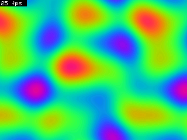
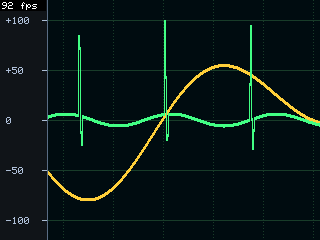
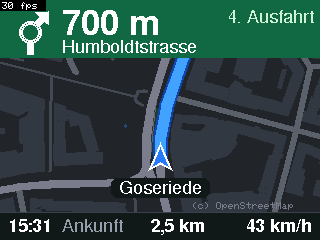

# ILI9341_GFX

[](https://github.com/JKBusse/ILI9341_GFX/actions/workflows/ci.yml)

A fast ILI9341 display driver for the ESP32 that is a drop-in **Adafruit_GFX** display class. It includes a framebuffer for flicker-free, high-frame-rate animation.

| Plasma | Synthwave | Fireworks | Chart | Navigation | Trip computer |
|---|---|---|---|---|---|
|  |  |  |  |  |  |

*These are real screenshots, read back from the display's RAM over SPI.*

## Contents

- [Highlights](#highlights)
- [Feature list](#feature-list)
- [Comparison with other libraries](#comparison-with-other-libraries)
- [Hardware requirements](#hardware-requirements)
- [Quick start](#quick-start)
- [API reference](#api-reference)
- [How it works](#how-it-works)
- [Project layout, building and testing](#project-layout)
- [Demo firmware and serial interface](#demo-firmware-and-serial-interface)
- [Limitations](#limitations)

## Highlights

- **Fastest in 11 of 13 benchmark tests.** It beats TFT_eSPI, LovyanGFX, Arduino_GFX and Adafruit_ILI9341, with lines 25 % faster and text 27 % faster than the next best. See the [benchmark](#performance).
- **Hardware D/C switching.** The ESP32's SPI unit runs in dual-output mode, and its second data line is routed through the GPIO matrix to the D/C pin. A whole draw operation (window, command and pixels) goes out as **one** SPI transfer instead of six. This needs no extra wiring.
- **Adafruit_GFX compatible.** The class derives from `Adafruit_GFX`, so existing Adafruit code and fonts work unchanged. The accelerated primitives draw **pixel-identically** to Adafruit_GFX, verified by about 1500 automated test cases.
- **Framebuffer with dirty-region tracking.** You redraw the whole frame and `display()` sends only what actually changed, using DMA, while the CPU renders the next frame.
- **Tear-free VSync.** The driver reads the panel's scanline and writes behind the refresh beam.

## Feature list

### Display driver (`ILI9341_GFX`)

- **Adafruit_GFX:**
  - Inherits from `Adafruit_GFX`: text, GFX fonts, lines, rectangles, circles, triangles, round rectangles and bitmaps.
  - API modelled on `Adafruit_ILI9341`: same constructor style, color constants and `begin()`.
- **Custom register-level SPI driver** on VSPI (SPI3), without the ESP-IDF transaction layer:
  - Asynchronous DMA command queue (64 entries) driven by an interrupt, with 2–16 DMA buffers of 6.4 KB.
  - Direct register path for small transfers when the queue is empty: no interrupt, no DMA setup.
  - Writes are fully asynchronous. Data is copied before `endWrite()` returns, so caller buffers can be reused at once.
- **Packed mode** (hardware D/C via SPI dual output, on by default):
  - `CASET`, `PASET`, `RAMWR` and the first pixels go out in a single transfer.
  - It also works for entries in the DMA queue: the interrupt expands them.
- **Accelerated, pixel-identical primitives:**
  - Lines (Bresenham runs instead of single pixels).
  - Circle outlines and round rectangles (runs in an order that needs fewer address updates).
  - Text with the built-in 5×7 font (one window per glyph) and with GFX fonts (runs).
  - `fillRect` and H/V lines.
- **Image transfer:**
  - `pushImage()` with clipping and big- or little-endian input.
  - `drawCanvas()` for `GFXcanvas16`.
- **Low-level access:** `setAddrWindow`, `writePixels`, `writeColor`, `writeCommand`, `spiWrite`, `sendCommand`, `setMadctl`.
- **Read back** (needs MISO):
  - `readRect()` for display RAM.
  - `readRegister()` and `readcommand8()`.
  - `getScanline()` for the current refresh line.
- **Automatic SPI clock:** `autoSpeed()` finds the highest clock that passes a readback test.
- **Hardware scrolling:** `setScrollMargins()` and `scrollTo()`.
- **Power saving:**
  - `setIdleMode()` for 8-color mode.
  - `setPartialMode()` to show only some panel rows.
  - `enableSleep()` and `enableDisplay()`.
- **Frame rate control** (`setFrameRate()`).
- **Fallback for other boards** (ESP32-S2/S3/C3, other Arduino platforms) through `SPIClass`, without the ESP32 accelerations. The macro `ILI9341_GFX_ESP32` is 1 when the fast path is active.

### Framebuffer (`ILI9341_Framebuffer`, `ILI9341_Framebuffer8`)

- **Two formats:**
  - 16 bit RGB565 (150 KB).
  - 8 bit (75 KB), stored as RGB332 or as indexes into a custom 256-color palette (palette cycling without redrawing).
- **Allocation:** The buffer is allocated in chunks, so it fits into the fragmented ESP32 heap **without PSRAM**.
- **Change detection:**
  - The buffer keeps a hash per 32-pixel row segment.
  - Only segments that were drawn into are re-hashed.
  - Changed segments are merged into rectangles when that is cheaper than opening extra windows (tunable with `setWindowCost()`).
- **Transfer:** `display()` streams the changes with DMA while the CPU goes on rendering.
- **VSync mode:**
  - Synchronises to the panel's scanline and writes behind the refresh beam in the panel's native direction.
  - Each frame appears in exactly one refresh, so there is no tearing.
  - For every frame it chooses the fastest refresh rate (about 92, 55 or 48 Hz) at which a simulation shows the transfer can stay behind the beam.
- **Hardware scrolling** with fixed areas at both ends (`setScrollArea()`, `scroll()`). It also works together with VSync and in all rotations.
- **All Adafruit_GFX drawing functions** write into RAM. Lines, filled triangles, filled circles and text have their own fast implementations, pixel-identical to Adafruit_GFX.
- **Direct buffer access:** `getRow()`, `markDirty()`, `getPixel()` and `pushImage()`.
- **Screenshots and checks:**
  - `screenshot()` sends a screenshot over any `Print` stream, and `extras/tools/tftctl.py` saves it as PNG.
  - `readDisplayRow()` is for verification.

## Comparison with other libraries

### Performance

All five libraries ran the same tests on the same hardware: NodeMCU-32S with an ILI9341 module at 40 MHz SPI. Values are milliseconds, lower is better.

| Test | Adafruit_ILI9341 | TFT_eSPI | LovyanGFX | Arduino_GFX | **ILI9341_GFX** |
|---|---:|---:|---:|---:|---:|
| FillScreen | 184.9 | 156.0 | 154.2 | 170.4 | **154.2** |
| Text | 25.9 | 13.3 | 9.3 | 16.9 | **6.8** |
| Lines | 1019.7 | 268.6 | 274.0 | 413.4 | **200.8** |
| H/V lines | 17.0 | 14.4 | 13.9 | 14.9 | **13.2** |
| Rects | 11.2 | 8.9 | 8.7 | 9.6 | **8.6** |
| FilledRects | 379.4 | 320.2 | **316.6** | 349.6 | 317.3 |
| FilledCircles | 70.3 | 47.0 | 44.3 | 52.2 | **40.9** |
| Circles | 114.6 | 26.5 | 26.5 | 40.7 | **19.8** |
| Triangles | 56.9 | 16.8 | 16.4 | 23.7 | **12.0** |
| FilledTriangles | 144.3 | 112.6 | **108.6** | 124.4 | 112.3 |
| RoundRects | 46.8 | 16.7 | 13.3 | 21.5 | **12.9** |
| FilledRoundRects | 390.7 | 326.9 | **322.6** | 362.3 | 324.9 |
| PushImage 320×240 | 36.1 | 33.4 | 31.3 | 34.8 | **30.9** |
| Full-screen animation (fps, higher is better) | – | 25.5 | 31.4 | – | **71.0** |

**Notes:**
- **Large fills are limited by the wire.** At 40 MHz, about 5 KB fits through per millisecond. The large fills (FillScreen, FilledRects, FilledRoundRects) are within about 4 % of that limit for every fast library.
- **How the animation test works:** It redraws a full-screen scene every frame and shows it without flicker. ILI9341_GFX uses its 16-bit framebuffer with dirty regions. The others use a full-screen sprite or canvas pushed every frame, and LovyanGFX had to use 8 bit for lack of RAM. "–" means the library had no full-screen buffer that fit into RAM.
- **Library versions:** Adafruit_ILI9341 1.6.1, TFT_eSPI 2.5.43, LovyanGFX 1.1.16 and Arduino_GFX 1.4.9. The benchmark source is in [`extras/bench/`](extras/bench/).

### Features

| Feature | Adafruit_ILI9341 | TFT_eSPI | LovyanGFX | Arduino_GFX | **ILI9341_GFX** |
|---|:---:|:---:|:---:|:---:|:---:|
| Derives from `Adafruit_GFX` | ✓ | – | – | – | ✓ |
| Supported controllers | ILI9341 | many | many | many | ILI9341 |
| Supported MCUs | all Arduino | ESP32, ESP8266, RP2040, STM32, … | ESP32 family, ESP8266, RP2040, SAMD, … | many | classic ESP32 (fast path), any Arduino board (plain SPI) |
| Configuration | constructor | compile-time `User_Setup.h` | config class | constructor | constructor |
| DMA transfers on ESP32 | – | ✓ (`pushImageDMA`) | ✓ | ✓ (some buses) | ✓ (all writes asynchronous) |
| Command + data in one SPI transfer (hardware D/C) | – | – | – | – | ✓ |
| Framebuffer with automatic dirty-region updates | – | – | – | – | ✓ |
| Tear-free VSync (scanline synchronised) | – | – | – | – | ✓ |
| Sprites / off-screen canvas | `GFXcanvas16` | ✓ | ✓ | ✓ (canvas) | framebuffer + `GFXcanvas16` |
| Anti-aliased (smooth) fonts | – | ✓ | ✓ | – | – |
| Touch controller support | – | ✓ (XPT2046) | ✓ | – | – |
| JPEG/PNG decoding built in | – | – (via add-on libs) | ✓ | – | – |
| Read back display RAM | – | ✓ | ✓ | – | ✓ |
| Screenshot to PC | – | – | – | – | ✓ |
| Automatic max-SPI-clock detection | – | – | – | – | ✓ |
| ILI9341 hardware scrolling API | ✓ | – ¹ | – ¹ | – ¹ | ✓ (also with framebuffer) |

The ✓ and – marks for the other libraries describe their documented, built-in features in the versions above. Add-on libraries and controller-specific extras are not counted.
¹ Possible by sending the scroll commands (33h/37h) yourself.

**When to pick something else:**
- **Controller:** If you need a display controller other than the ILI9341, use TFT_eSPI, LovyanGFX or Arduino_GFX.
- **MCU:** For an ESP32-S2, S3 or C3, use LovyanGFX or TFT_eSPI.
- **Missing features:** If you need anti-aliased fonts, touch or built-in JPEG/PNG decoding, use LovyanGFX or TFT_eSPI.

## Hardware requirements

| Item | Requirement |
|---|---|
| MCU | **Classic ESP32** (ESP32-D0WD/WROOM/WROVER, e.g. NodeMCU-32S, DevKitC) for the fast path. The accelerated driver programs the SPI3 (VSPI) registers of the original ESP32 directly. ESP32-S2/S3/C3/C6 and other Arduino boards compile with the plain `SPIClass` path, without DMA, packed mode, framebuffer VSync or readback. That path is tested in the host simulator and compiled in CI for ESP32-S3, ESP32-C3 and Arduino Uno. |
| Framework | Arduino core for ESP32 **2.0.x** (ESP-IDF 4.4) and **3.x** (ESP-IDF 5.x). Tested on hardware with 2.0.17 and 3.3.12, with the same results and speed. In PlatformIO, `platform = espressif32` gives core 2. For core 3, use the [pioarduino](https://github.com/pioarduino/platform-espressif32) platform. |
| Display | ILI9341 240×320 module in **4-wire SPI mode** (separate D/C line), 3.3 V logic |
| SPI clock | 40 MHz (default). The ESP32 can go up to 80 MHz, but the tested panel failed the readback check there. `autoSpeed()` finds the limit for your panel. |
| SPI bus | VSPI is used **exclusively**. Other SPI devices (SD card, touch) belong on HSPI. |
| Pins | SCK 18, MOSI 23, MISO 19 (default, IOMUX). CS and RST: any GPIO, or -1. **D/C: any output-capable GPIO (0–33)**, routed through the GPIO matrix in packed mode. |
| MISO | Optional for drawing. **Required** for VSync, readback, screenshots, `autoSpeed()` and `verifyPacked()`. |
| RAM: driver | About 52 KB of DMA-capable RAM with the default 8 DMA buffers (6.4 KB each). Use `begin(freq, n)` with fewer buffers to save RAM. |
| RAM: framebuffer | 16 bit: 150 KB plus 10 KB hashes. 8 bit: 75 KB plus 10 KB. No PSRAM needed. The buffer is split into blocks of mixed sizes (1.9 to 38 KB), so it also fits into a fragmented heap. If the heap is still too small, `fb.begin()` takes back DMA buffers from the driver, keeping at least 4. |
| CPU | 240 MHz recommended (Arduino default) |

**Tested wiring** (NodeMCU-32S):

| Display pin | ESP32 |
|---|---|
| VCC | 3V3 |
| GND | GND |
| CS | GPIO 15 |
| RESET | GPIO 4 |
| D/C | GPIO 2 |
| SDI (MOSI) | GPIO 23 |
| SCK | GPIO 18 |
| LED | GPIO 13 (backlight, or 3V3) |
| SDO (MISO) | GPIO 19 |

**With Wi-Fi:** The 16-bit framebuffer and Wi-Fi together leave little heap. `fb.begin()` frees DMA buffers on its own if needed. If it still returns `false`, use `ILI9341_Framebuffer8`.

## Quick start

### Installation

- **Arduino IDE:** Install `ILI9341_GFX` through the Library Manager. *Adafruit GFX Library* is installed with it. Until the library appears in the Library Manager, download the repository as ZIP and use *Sketch → Include Library → Add .ZIP Library*.
- **PlatformIO:** Add the library from the [PlatformIO registry](https://registry.platformio.org/libraries/jkbusse/ILI9341_GFX) to `platformio.ini`:

  ```ini
  [env:esp32]
  platform = espressif32
  board = nodemcu-32s
  framework = arduino
  lib_deps = jkbusse/ILI9341_GFX
  build_unflags = -Os
  build_flags = -O2
  ```

### Example

```cpp
#include <ILI9341_GFX.h>
#include <ILI9341_Framebuffer.h>

ILI9341_GFX tft(15, 2, 4);          // CS, DC, RST (SCK 18, MOSI 23, MISO 19)
ILI9341_Framebuffer fb(tft);

void setup() {
  tft.begin();                      // 40 MHz, packed mode on
  fb.begin();                       // 150 KB framebuffer
  fb.setRotation(1);
  fb.setVSync(true);                // tear-free (needs MISO)
}

void loop() {
  fb.fillScreen(ILI9341_BLACK);     // redraw everything ...
  fb.fillCircle(160 + 100 * sin(millis() / 500.0), 120, 30, ILI9341_ORANGE);
  fb.display();                     // ... but only changes are sent
}
```

There are two examples:
- [`Basic`](examples/Basic/Basic.ino) draws directly on the display.
- [`Framebuffer`](examples/Framebuffer/Framebuffer.ino) is a bouncing-balls animation with VSync.

## API reference

### `ILI9341_GFX`

**Setup and bus**

| Function | Description |
|---|---|
| `ILI9341_GFX(cs, dc, rst = -1, sck = 18, mosi = 23, miso = 19)` | ESP32 constructor. Use -1 for an unused CS, RST or MISO. |
| `ILI9341_GFX(cs, dc, rst = -1, SPIClass *spi = &SPI)` | Constructor on other platforms |
| `begin(freq = 40 MHz, dmaBuffers = 8)` | Resets and initialises the panel, allocates DMA buffers and enables packed mode. On other platforms the call is `begin(freq)`. |
| `setSPISpeed(freq)`, `spiSpeed()` | Set or get the SPI write clock |
| `autoSpeed(maxFreq = 80 MHz)` | Finds the highest clock that passes a readback test and sets it. The panel is re-initialised, so content is lost. Returns Hz. |
| `dmaBufferCount()` | DMA buffers actually allocated |
| `releaseDmaBuffers(keep)` | Free DMA buffers until `keep` (at least 2) remain. `fb.begin()` uses this when RAM is short. |
| `finishWrites()` | Waits for all queued transfers and releases CS |
| `pendingBytes()` | Bytes still waiting in the DMA queue |
| `setPacked(on)`, `packed()` | Switch packed mode (hardware D/C) on or off |
| `verifyPacked(seed = 1)` | Readback self-test of packed mode (needs 2 KB heap). Returns the number of wrong pixels (0 = OK), or `UINT32_MAX` if there was no RAM for the test. |
| `reinitPanel()` | Hardware reset and init sequence again |

**Drawing**

| Function | Description |
|---|---|
| All `Adafruit_GFX` functions | `drawPixel`, `drawLine`, `drawRect`, `fillRect`, `fillScreen`, `drawCircle`, `fillCircle`, `drawTriangle`, `fillTriangle`, `drawRoundRect`, `fillRoundRect`, `drawBitmap`, `drawRGBBitmap`, `drawChar`, `print`/`printf`, `setFont`, `setTextSize`, `setTextColor`, `setCursor`, `setTextWrap`, `getTextBounds`, `setRotation`, `width`, `height`, … |
| `pushImage(x, y, w, h, data, bigEndian = false)` | Blit RGB565 data, with clipping |
| `drawCanvas(x, y, GFXcanvas16 &canvas)` | Blit a whole `GFXcanvas16` |
| `invertDisplay(bool)` | Inverts the display colors |
| `color565(r, g, b)` | Static: 8-bit RGB to RGB565 |

**Low level** (between `startWrite()` and `endWrite()`)

| Function | Description |
|---|---|
| `startWrite()`, `endWrite()` | Start and end a batch. `endWrite()` does not wait for the transfer. |
| `setAddrWindow(x, y, w, h)` | Set the window and start `RAMWR` (no clipping) |
| `writePixels(colors, len, bigEndian = false)` | Write pixels into the window |
| `writeColor(color, len)` | Write one color `len` times |
| `writeCommand(cmd)`, `spiWrite(b)`, `spiWrite16(w)` | Raw command or data bytes |
| `sendCommand(cmd, data, len)` | Command with parameters |
| `setMadctl(value)`, `rotationMadctl()` | Set raw MADCTL, or get the value for the current rotation |
| `pixelSpace(maxPx, &n)`, `commitPixels(n)` | Write pixels straight into the current DMA buffer, for custom pixel generators |
| `setFrameRate(diva, rtna)` | Panel refresh rate (FRMCTR1) |

**Reading** (needs MISO)

| Function | Description |
|---|---|
| `readRect(x, y, w, h, out)` | Read display RAM as RGB565 |
| `readcommand8(cmd, index = 0)` | Read one register byte (Adafruit compatible) |
| `readRegister(cmd, buf, len)` | Read raw register bytes |
| `getScanline()` | Line the panel is currently refreshing (0 = start of VSYNC) |

**Scrolling and power**

| Function | Description |
|---|---|
| `setScrollMargins(top, bottom)`, `scrollTo(y)` | Hardware vertical scrolling |
| `enableDisplay(bool)` | Display on or off (content kept) |
| `enableSleep(bool)` | Sleep mode (a few µA in the panel, content kept) |
| `setIdleMode(bool)` | 8-color idle mode (lower power) |
| `setPartialMode(enable, first, last)` | Show only panel rows `first..last` |

### `ILI9341_Framebuffer` (16 bit) / `ILI9341_Framebuffer8` (8 bit)

| Function | Description |
|---|---|
| `ILI9341_Framebuffer fb(tft)` | Create a framebuffer for a display (no allocation yet) |
| `begin()` | Allocate the buffer (call after `tft.begin()`). Frees DMA buffers of the driver if needed (at least 4 remain). Returns `false` if RAM is short. |
| All `Adafruit_GFX` functions | Draw into RAM |
| `display()` | Send the changed regions to the display |
| `invalidate()` | Make the next `display()` send everything, e.g. after drawing directly on `tft` |
| `lastPixelsSent()` | Pixels sent by the last `display()` |
| `setWindowCost(px)` | Cost of a new address window in pixels (default 200), used for merging regions |
| `setVSync(bool)`, `vsync()` | Tear-free mode (needs MISO) |
| `refreshHz()` | Panel refresh rate currently in use |
| `vsyncLate()` | Number of strips sent too late, where tearing was possible |
| `setScrollArea(fixedStart, fixedEnd)` | Fixed areas at the start and end of the scroll axis |
| `scroll(delta)` | Scroll the area by `delta` pixels in hardware. Redraw the strip that becomes free, then call `display()`. |
| `pushImage(x, y, w, h, data)` | Copy RGB565 data into the buffer |
| `getPixel(x, y)` | Pixel as RGB565 |
| `getRow(y)` | Pointer to a raw buffer row (`uint16_t*` or `uint8_t*`). Marks the row as changed. |
| `markDirty(x, y, w, h)` | Mark an area as changed after direct buffer writes |
| `screenshot(Print &out)` | Stream a screenshot (`SHOT w h` header plus RGB565) |
| `readDisplayRow(y, out)` | Read back what the display shows in row `y` |
| `setPalette(colors, n = 256)` | 8 bit only: use palette indexes instead of RGB332 |
| `useRGB332()` | 8 bit only: back to RGB332 |
| `color332(c565)` | Static: RGB565 to RGB332 |

## How it works

### Two paths to the panel

- **Direct path.** When the queue is empty, small transfers go straight through the SPI data registers W0–W15. Nothing waits for completion, and no interrupt or DMA setup is involved.
- **DMA queue.** Larger transfers run through a ring of 64 entries, fed by DMA from 6.4 KB buffers. The interrupt starts each next entry while the CPU keeps drawing.
- **Switching rule.** If only a short backlog remains (under 8 KB), small drawing operations wait for the queue to drain and then use the faster direct path.

### Packed mode

- **D/C sampling.** The ILI9341 samples D/C only at the last bit of each byte.
- **Dual output.** In dual-output mode the ESP32's SPI unit shifts out two bits per clock. MOSI carries the data bit, and the Q line, routed to the D/C pin by the GPIO matrix, carries the matching D/C level.
- **Byte spreading.** Every byte is spread to 16 buffer bits. `CASET x0 x1 PASET y0 y1 RAMWR` plus the first pixels then fit into one transfer.
- **Timing.** The D/C timing comes from the SPI clock itself, so CPU load and Wi-Fi cannot disturb it.

### Framebuffer diffing

- **Hashes.** Each row is split into 32-pixel segments, each with an FNV hash.
- **Rehashing.** Drawing operations mark the segments they touch, and only those are re-hashed on `display()`.
- **Merging.** Changed segments are grouped into bands and rectangles. A new window is only opened if the gap it skips costs more than `setWindowCost()` pixels.

### VSync

- **Scanline.** The panel's scanline comes from command 45h. The transfer then runs in the panel's native row direction, always behind the refresh.
- **Rate choice.** For every frame, a feasibility simulation over the dirty bands picks the fastest refresh rate that cannot be overtaken.
- **Scroll changes** are applied during the vertical porch.

ESP32 quirks found along the way are documented in the source comments: DMA reset sequences, full-duplex register clobbering and late `trans_done` flags.

<a id="project-layout"></a>
## Project layout, building and testing

```
src/                    the library: driver and framebuffer
examples/               Arduino examples
library.properties      Arduino Library Manager metadata
library.json            PlatformIO registry metadata
extras/demo/            demo firmware: 6 scenes, serial measurement interface
extras/bench/           benchmark against other libraries
extras/tools/tftctl.py  control the demo, read fps/verification, save screenshots as PNG
extras/tools/benchrun.py  flash all benchmark firmwares and print a comparison table
extras/tools/mapgen.py  generate the map data for the navigation scene (OpenStreetMap + OSRM)
extras/test/host/       host tests: pixel-identical to Adafruit_GFX
extras/docs/            images for this README
```

The repository is both the library and a PlatformIO project for the demo, the benchmark and the tests. `platformio.ini` sets `src_dir = extras/demo` and links the library from the repository root (`symlink://.`). The Arduino IDE ignores `extras/`.

The development project builds with [PlatformIO](https://platformio.org/). The serial port is set in `platformio.ini` (`/dev/cu.usbserial-0001`), so adjust it for your machine.

```sh
pio run -e nodemcu-32s -t upload                  # demo firmware
pio device monitor                                # 921600 baud
extras/test/host/run.sh                           # host tests (after one pio run)
python3 extras/tools/benchrun.py                  # benchmark all libraries
python3 extras/tools/benchrun.py bench_ours       # benchmark this library only
python3 extras/tools/tftctl.py t T20 D V10 -t 10  # on-board checks
```

**Continuous integration** ([`.github/workflows/ci.yml`](.github/workflows/ci.yml)) runs on every push:
- Arduino Lint in the strict Library Manager mode.
- The host tests.
- The examples, compiled for ESP32 with core 2.0.17 and 3.3.12, for ESP32-S3 and ESP32-C3, and for Arduino Uno.
- The demo firmware, built with PlatformIO for core 2 and core 3.

**What the host tests do:**
- They compile the driver and framebuffer for the PC against a simulated ILI9341.
- They compare every pixel with Adafruit_GFX for lines, circles, round rectangles, triangles and text in all fonts, sizes and rotations.
- They also check dirty-region updates and hardware scrolling in all rotations.

## Demo firmware and serial interface

The demo cycles through six scenes and prints a status line every second.

The navigation scene drives a real route through Hannover, from Steintor to the HDI Arena. The map is OpenStreetMap data (streets, buildings, water, parks), and the turn-by-turn instructions come from the OSRM router. `extras/tools/mapgen.py` downloads and simplifies both into `extras/demo/nav_map.h`, about 180 KB in flash, sorted into a 128 m grid. The map rotates with the driving direction and is redrawn completely every frame, at about 30 fps with VSync.

Status line:

```
STAT scene=Synthwave fps=92 render_us=... display_us=... px=... spi_mhz=40 heap=... vsync=1 late=0
```

Commands (each followed by a newline):

| Command | Action |
|---|---|
| `s<n>` / `a` | Hold scene n (0 Plasma, 1 Synthwave, 2 Fireworks, 3 Trip computer, 4 Chart, 5 Navigation), or cycle automatically |
| `y1` / `y0` | VSync on / off |
| `f<MHz>` | Set SPI clock |
| `o<n>` | Rotation of the current scene |
| `b` | Timing benchmark of the render and display steps |
| `v`, `V<n>` | Read back the display and compare with the framebuffer (once, or for n frames) |
| `t`, `D`, `T<n>` | Driver self-test, direct-drawing test, n packed-mode tests |
| `TA` / `TO` | Packed mode on / off |
| `P` | Send a screenshot |
| `i1`/`i0`, `p<a>,<b>`/`p0`, `z1`/`z0` | Idle mode, partial display, sleep |
| `c<cmd> <param>…`, `R<cmd> <n>`, `g` | Send a raw command, read a register, sample the scanline |

`extras/tools/tftctl.py` drives this from the PC:

```sh
python3 extras/tools/tftctl.py s1 @3 V10 -t 5     # Synthwave, wait 3 s, verify 10 frames
python3 extras/tools/tftctl.py s4 @4 --shot chart.png  # screenshot as PNG
python3 extras/tools/tftctl.py --listen shots/    # Enter or BOOT button = screenshot
```

## Limitations

- **Hardware.** The library supports one controller (ILI9341). The fast path needs a classic ESP32, while other boards only get the plain SPI path.
- **Missing features.** There are no anti-aliased fonts, no touch support and no image decoders. They combine fine with external libraries, for example XPT2046_Touchscreen on HSPI, or a JPEG decoder feeding `pushImage()`.
- **Language.** The source code comments are in German.

## License

[MIT](LICENSE). The map data of the navigation demo (`extras/demo/nav_map.h`) is © [OpenStreetMap contributors](https://www.openstreetmap.org/copyright), licensed under the ODbL. The library uses the [Adafruit GFX Library](https://github.com/adafruit/Adafruit-GFX-Library) (BSD license) as a dependency, including its built-in 5×7 font.
